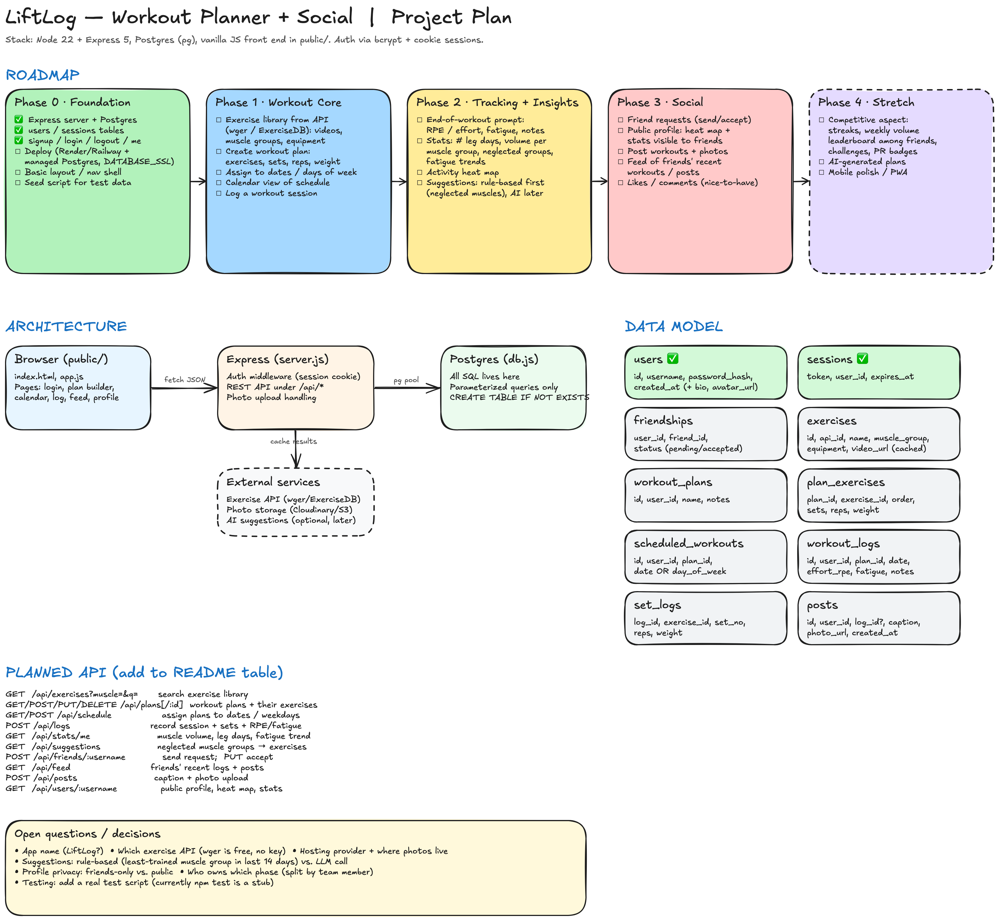

# Project Plan (LiftLog, name TODO)

A workout planner with a social side. Users build workout plans, schedule them, log what they actually did, see stats about their training over time, and share it with friends.



The diagram source is [`project-plan.excalidraw`](project-plan.excalidraw). To edit it, open it at excalidraw.com (Menu → Open) or use the shared room. Re-export both files when it changes.

## Where we are

| Area | Status |
|---|---|
| Express server, Postgres connection, auto-created tables | done (`main`) |
| `users` and `sessions` tables, signup / login / logout / me | done (`main`) |
| Signup validation, login rate limit, hashed session tokens, home page + login dialog | on the `Peter` branch, not merged yet |
| Wireframes | Create Workout (#6) and View Workouts (#7) done. Homepage/Feed (#1), Account (#5), Goals (#8), Plan (#9), Settings (#10) open |
| DB schema for feed (#2), exercise API (#4), login styling (#3) | open |
| Deployment | not started |

## Architecture

```
Browser (public/)  --fetch JSON-->  Express (server.js)  --pg pool-->  Postgres (db.js)
                                         |
                                         +--> Exercise API (wger / ExerciseDB), cached in our DB
                                         +--> Photo storage (Cloudinary / S3)
                                         +--> AI suggestions (optional, later)
```

- **Front end**: plain HTML/JS in `public/`. If it gets big, split it into one JS file per page before reaching for a framework.
- **Server**: Express 5. Every `/api/*` route that touches user data uses `requireAuth`. Routes can move into `routes/*.js` once `server.js` gets crowded.
- **Database**: all SQL lives in `db.js` (or `db/*.js` later). Use parameterized queries only, and add schema changes with `CREATE TABLE IF NOT EXISTS`.
- **External exercise data**: fetch from the API once and store it in `exercises`, so we don't hit rate limits or depend on the API being up during demos.
- **Photos**: don't put image bytes in Postgres. Upload them to a storage service and store the URL.

## Pages

These line up with the wireframe issues.

| Page | What it does | Issue |
|---|---|---|
| Home / Feed | Friends' recent workouts and posts. Logged-out visitors see the landing page + login | #1, #2 |
| Create Workout | Pick exercises (search the library), set sets/reps/weight, save as a plan | #6 |
| Plan | Calendar/week view and assigning plans to dates or days of the week | #9 |
| View Workouts | History of logged sessions, with the stats and heat map | #7 |
| Goals | Targets like "squat 225" or "3 leg days a month", with progress against them | #8 |
| Account / Profile | Public profile: heat map, stats, posts, friend button | #5 |
| Settings | Username/password, privacy (friends-only vs public) | #10 |
| Log workout | Check off sets during a session, then the end-of-workout prompt (effort, fatigue, notes) | none yet |

## Data model

The tables already built are marked ✅. Everything else is a proposal, so change it once the wireframes are done (#2).

```sql
users ✅            (id, username, password_hash, created_at)       -- + bio, avatar_url, is_private
sessions ✅         (token, user_id, expires_at)

friendships        (user_id, friend_id, status 'pending'|'accepted', created_at)
                   -- one row per request; accepted = friends both ways

exercises          (id, api_id, name, muscle_group, secondary_muscles, equipment, video_url, description)

workout_plans      (id, user_id, name, notes, created_at)
plan_exercises     (plan_id, exercise_id, position, sets, reps, weight)

scheduled_workouts (id, user_id, plan_id, date NULL, day_of_week NULL)
                   -- exactly one of date / day_of_week is set

workout_logs       (id, user_id, plan_id NULL, performed_at, effort_rpe 1-10, fatigue 1-5, notes)
set_logs           (log_id, exercise_id, set_no, reps, weight)

goals              (id, user_id, kind, target, exercise_id NULL, deadline NULL, achieved_at NULL)

posts              (id, author_id, log_id NULL, content, photo_url, created_at)
```

### Feed query

Friendships are one row per pair, so a user can be on either side. Check both columns. `UNION` removes duplicates, and the user's own posts are included.

```sql
SELECT p.id, p.content, p.photo_url, p.created_at, u.username AS author
FROM posts p
JOIN users u ON u.id = p.author_id
WHERE p.author_id = $1
   OR p.author_id IN (
     SELECT friend_id FROM friendships WHERE user_id = $1 AND status = 'accepted'
     UNION
     SELECT user_id FROM friendships WHERE friend_id = $1 AND status = 'accepted'
   )
ORDER BY p.created_at DESC
LIMIT 20;
```

`$1` is `req.user.id`. For "load more", add `AND p.created_at < $2` and pass the oldest `created_at` already shown.

The stats only work if we log what was actually done (`set_logs`), not just what was planned (`plan_exercises`). Keep them as separate tables.

## API

New endpoints go in the README API table once they exist.

| Method | Path | Purpose |
|---|---|---|
| GET | `/api/exercises?q=&muscle=` | Search the exercise library |
| GET/POST | `/api/plans` | List or create plans |
| GET/PUT/DELETE | `/api/plans/:id` | One plan and its exercises |
| GET/POST | `/api/schedule` | Assign plans to dates / weekdays |
| POST | `/api/logs` | Record a session: sets plus effort/fatigue/notes |
| GET | `/api/logs?from=&to=` | Workout history |
| GET | `/api/stats/me` | Volume per muscle group, leg-day count, fatigue trend, heat map data |
| GET | `/api/suggestions` | Exercises for neglected muscle groups |
| GET/POST | `/api/goals` | Goals and progress |
| POST | `/api/friends/:username` | Send a friend request |
| PUT/DELETE | `/api/friends/:username` | Accept, or remove/decline |
| GET | `/api/feed` | Friends' recent logs and posts |
| POST | `/api/posts` | Text content + optional photo |
| GET | `/api/users/:username` | Public profile (respects privacy setting) |

## Roadmap

### Phase 0: Foundation
- [x] Express + Postgres, users/sessions, signup/login/logout/me
- [ ] Merge `Peter` branch (validation, rate limiting, home page)
- [ ] Deploy (Render or Railway + managed Postgres; set `DATABASE_SSL`, `NODE_ENV`)
- [ ] Shared page layout / nav
- [ ] Seed script with test users and workouts (makes stats and feed testable)
- [ ] Finish wireframes (#1, #5, #8, #9, #10)

### Phase 1: Workout core
- [ ] Pick an exercise API and cache it in `exercises` (#4)
- [ ] Create Workout page: build a plan from exercises with sets/reps/weight
- [ ] Plan page: schedule plans on dates or days of the week
- [ ] Log a workout, pre-filled from the scheduled plan

### Phase 2: Tracking + insights
- [ ] End-of-workout prompt: effort (RPE), fatigue, notes
- [ ] Stats: leg days per month, volume per muscle group, neglected muscle groups, fatigue trend
- [ ] Heat map of training days (GitHub-style calendar)
- [ ] Goals and progress
- [ ] Suggestions (see below)

### Phase 3: Social
- [ ] Friend requests
- [ ] Public profile with heat map + stats (friends-only by default)
- [ ] Posts with photos
- [ ] Friends feed
- [ ] Likes/comments if there's time

### Phase 4: Stretch
- [ ] Competition: streaks, weekly volume leaderboard among friends, challenges, PR badges
- [ ] AI-generated plans
- [ ] Mobile polish / installable PWA

## Suggestions: start simple

1. For each muscle group, sum the sets logged in the last 14 days.
2. Pick the 1–2 lowest groups (skip any trained in the last 48h).
3. Suggest exercises from those groups the user hasn't done recently.
4. If recent fatigue reports are high, suggest a lighter day or rest instead.

This is all plain SQL and needs no API key. An LLM call can come later and use the same stats as its input.

## Open questions

- App name: LiftLog?
- Exercise API: wger is free and needs no key; ExerciseDB has better videos but needs a key
- Hosting, and where photos live
- Profiles: friends-only, or public with an opt-out?
- Who owns which phase/page?
- Testing: `npm test` is still a stub. At least add API tests for auth and logging.

## Conventions (from the README)

- Parameterized SQL only; schema changes go in `db.js` with `CREATE TABLE IF NOT EXISTS`
- Keep the README's API table and project structure up to date
- No secrets, `.env`, or `node_modules` in commits
- One branch per feature, merged by PR, referencing the issue (`Closes #9`)
